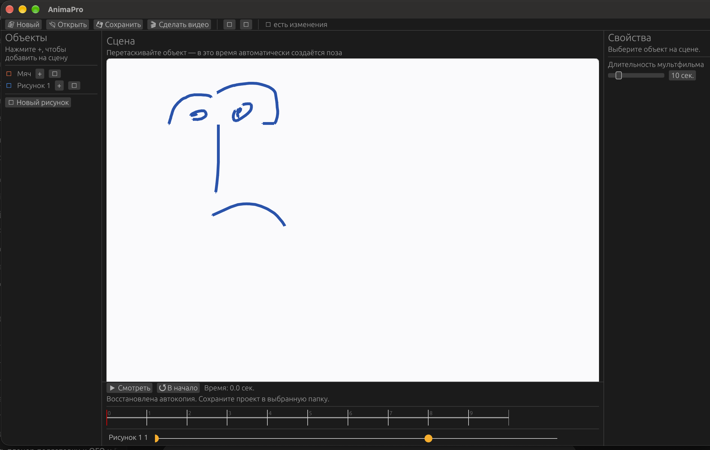

# AnimaPro

> Учебный редактор анимации на Rust — чтобы ребёнок мог нарисовать объект, задать ему движение и получить свой первый мультфильм.

**AnimaPro** — офлайн-приложение с русским интерфейсом для школьников 4–5 класса. Оно заменяет сложные термины понятными словами: «объект», «поза» и «движение».



## Состояние проекта

AnimaPro пока находится в разработке и не прошёл полную приёмку для учебного релиза. Доступны сцена, редактор рисунков, позы, сохранение и экспорт видео. Основные сценарии и обработка некоторых отказов покрыты автоматическими тестами; полный сценарий работы и поставка на обеих платформах ещё требуют ручной проверки.

Для продолжения работы: [текущее состояние и передача работы](docs/HANDOFF.md), [исходный план подготовки релиза](docs/RELEASE_PLAN.md).

## Первый мультфильм за три шага

1. Нажмите **На сцену** у «Мяча» в библиотеке объектов.
2. Переместите указатель времени и перетащите мяч на сцене — новая поза появится автоматически.
3. Нажмите **Смотреть**, а затем **Сделать видео**.

## Возможности

- Сцена с порядком перекрытия объектов и независимыми анимациями экземпляров.
- Светлая и тёмная темы с переключением в «Помощь и настройки»; выбор действует до закрытия приложения.
- Плавное или равномерное движение выбирается для каждой позы; позы можно добавлять, выбирать, перемещать и удалять.
- Редактор рисунка в отдельном окне: штрихи, линии, прямоугольники, овалы, цвет, толщина и заливка.
- «Создать копию» — для независимого рисунка; изменения исходника видны всем его экземплярам.
- Проекты в переносимом ZIP-контейнере `.animapro` с версионированным JSON.
- Сохранение через временный файл. Для изменённого проекта создаётся фоновая автокопия каждые 30 секунд; после сбоя приложение предлагает восстановить оставшиеся копии по отдельности.
- Фоновый экспорт MP4 с прогрессом и отменой; готовый файл публикуется только при успехе.

## Быстрый старт

Проект закреплён за Rust **1.90.0** (`rust-toolchain.toml`); для экспорта нужен FFmpeg с кодировщиком `libx264`.

```bash
cargo run --release
```

Проверить код:

```bash
cargo fmt --check
cargo clippy --offline --locked --all-targets -- -D warnings
cargo test --offline --locked
```

## Экспорт видео

Экспорт создаёт MP4 в формате **H.264, 1280×720, 30 кадров/с**, без звука. Во время разработки приложение использует `ffmpeg` из `PATH`; в готовой поставке он должен лежать рядом с приложением:

- macOS: `AnimaPro.app/Contents/Resources/ffmpeg`
- Windows: рядом с `AnimaPro.exe`

## Сборка поставки

### macOS (Apple Silicon + Intel)

Нужен **universal** redistributable FFmpeg с `libx264`:

```bash
ANIMAPRO_FFMPEG_MACOS=/absolute/path/to/ffmpeg \
ANIMAPRO_FFMPEG_NOTICE_DIR=/absolute/path/to/notices \
./scripts/package-macos.sh
```

Скрипт создаёт `dist/AnimaPro.app` и проверяет, что FFmpeg содержит одновременно `arm64` и `x86_64`. Чтобы сохранить предыдущий пакет, можно задать другое имя в каталоге `dist`, например `ANIMAPRO_PACKAGE_NAME=AnimaPro-test.app`.

### Windows x64

Запустите на Windows с Rust MSVC target:

```powershell
.\scripts\package-windows.ps1 -FfmpegPath C:\path\to\ffmpeg.exe -FfmpegNoticesPath C:\path\to\notices
```

Результат появится в `dist\AnimaPro-windows-x64`.

Обе команды требуют папку с непустыми файлами `FFMPEG-LICENSE.txt` и `FFMPEG-SOURCE.txt` для конкретного бинарника. В поставку также включаются перечень зависимостей и сведения о сборке и контрольной сумме FFmpeg. Подробности: [сведения о зависимостях](docs/DEPENDENCIES.md).

## Проверка перед выпуском

Контрольное [измерение производительности](docs/PERFORMANCE.md). Ручной приёмочный сценарий: [docs/MANUAL_TEST.md](docs/MANUAL_TEST.md). Краткая [памятка для учителя](docs/TEACHER_GUIDE.md).

Автоматические тесты проверяют, в частности, хранение и миграцию проектов, восстановление отдельных сессий, историю жеста, геометрию и обработку отказов экспорта. При наличии FFmpeg с libx264 и ffprobe выполняется сквозная проверка: рисунок сохраняется, открывается и экспортируется; затем проверяются содержимое и свойства видео. Это не заменяет ручную приёмку.

В автоматической сборке устанавливается FFmpeg при необходимости и задаётся `ANIMAPRO_REQUIRE_FFMPEG_TESTS=1`: отсутствие FFmpeg, libx264 или ffprobe тогда приводит к ошибке тестов. Для такой же обязательной проверки локально задайте эту переменную перед `cargo test`.

## Структура

```text
src/main.rs                 запуск приложения
src/model.rs                модель проекта
src/animation.rs            вычисление анимации
src/timeline.rs             выбор и отображение поз на шкале
src/app.rs                  интерфейс и состояние редактирования
src/scene.rs                общая отрисовка сцены и видео
src/export.rs               экспорт видео и управление кодировщиком
src/storage.rs              чтение, проверка и запись проектов
src/recovery.rs             фоновые копии отдельных сессий
src/diagnostics.rs          ограниченный журнал категорий ошибок
scripts/package-macos.sh    сборка universal macOS .app
scripts/package-windows.ps1 сборка переносимой папки Windows x64
docs/MANUAL_TEST.md         ручная приёмка
dashboard-site/             локальный дашборд хода разработки
```

## Известные ограничения

- Импорт PNG/JPEG, звук, облачная и совместная работа пока не реализованы.
- Доступность, производительность под нагрузкой и обработка ряда отказов требуют дальнейшей проверки.
- Локальный журнал содержит только время и категории ошибок, без содержимого рисунков, путей и вывода FFmpeg. Кнопка «Копировать сведения» копирует версию приложения, ОС и архитектуру.
- Прежняя общая автокопия во временной папке не переносится автоматически в новый механизм восстановления.
- Перед распространением нужно приложить redistributable FFmpeg для обеих платформ и пройти ручную проверку на macOS и Windows.

## Лицензия

AnimaPro доступен по [лицензии MIT](LICENSE). Сторонние компоненты, включая FFmpeg, распространяются на собственных условиях; сведения приведены в [перечне зависимостей](docs/DEPENDENCIES.md).

---

Сделано на Rust с `eframe/egui`, `tiny-skia`, FFmpeg и ❤️ к первым мультфильмам.
